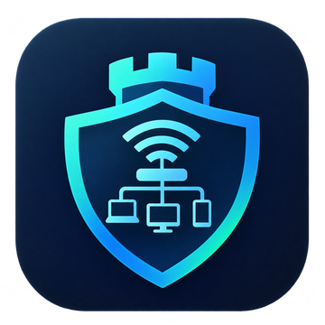

<h1 align="center">LanWarden</h1>

<p align="center">
  
</p>

<p align="center"><em>Self-hosted LAN device monitor with AdGuard Home integration.</em></p>

<p align="center">
  <a href="https://github.com/iamenr0s/lanwarden/actions/workflows/ci.yml"></a>
  <a href="https://github.com/iamenr0s/lanwarden/releases"></a>
  
  
  
  
</p>

<p align="center">
  <a href="docs/SECURITY.md"></a>
  
  
  <a href="https://codecov.io/gh/iamenr0s/lanwarden"></a>
  
  <a href="renovate.json"></a>
</p>

<p align="center">
  
  
  
  
  
  
  
  
  
</p>

LanWarden discovers the devices on your LAN or Wi-Fi, keeps a persistent inventory, tracks when each one is online,
and alerts you to unknown devices. It can also use **AdGuard Home** as an extra source of device names and DNS
activity. Inspired by the concepts of [Pi.Alert](https://github.com/pucherot/Pi.Alert) and written from scratch.

## Features

* Device discovery with arp-scan and the kernel neighbour table, merged into one inventory per MAC
* Presence timelines, IP and hostname history, and events for every change
* Vendor lookup (offline IEEE registry), automatic device type, and model names from mDNS and SSDP
* Email and webhook notifications, with spoofing and conflict detection
* AdGuard Home integration: DHCP leases, clients and query log
* Dashboard with charts; single admin with optional two-step verification, optional HTTPS and database encryption

Details: [docs/FEATURES.md](docs/FEATURES.md).

## Quick start

Needs Docker or Podman on the machine that sits on the LAN you want to watch.

```bash
git clone https://github.com/iamenr0s/lanwarden && cd lanwarden
scripts/run-container.sh        # builds and starts; also: logs, status, down
```

Or run the published image (amd64 and arm64):

```bash
LANWARDEN_IMAGE=quay.io/iamenr0s/lanwarden:latest scripts/run-container.sh     # or docker.io/iamenr0s/lanwarden:latest
```

Open `http://<host>:8080` and create the administrator account. Until you do, anyone who can reach the port can
claim it.

LanWarden uses host networking, so the port is set with `LANWARDEN_PORT`. Rootless Podman cannot run arp-scan; it
falls back to the neighbour table.

## Documentation

| | |
|---|---|
| [Install and configure](docs/INSTALL.md) | Compose, Podman service, HTTPS and reverse proxy, native install, environment variables |
| [Features](docs/FEATURES.md) | Scanning, dashboard, presence, notifications, AdGuard Home |
| [Secrets and recovery](docs/SECRETS.md) | Key handling, rotation, database encryption, two-step verification, lockout recovery |
| [Security](docs/SECURITY.md) | Threat model, controls, residual risks, verifying signed images |
| [Design](docs/DESIGN.md) | Architecture, schema, API |
| [Development](docs/DEVELOPMENT.md) | Running from source, tests, layout, publishing |

## Contributing

Contributions are welcome — see [CONTRIBUTING.md](CONTRIBUTING.md) for the
local pipeline commands and pull request checklist. This project follows the
[Contributor Covenant Code of Conduct](CODE_OF_CONDUCT.md).

## Security

See [docs/SECURITY.md](docs/SECURITY.md) — GitHub private vulnerability reporting, no
public issues for security bugs.

## License

This project is licensed under the [MIT License](LICENSE).

## Author Information

Author: iamenr0s
